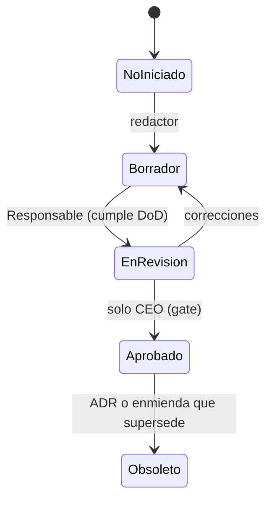
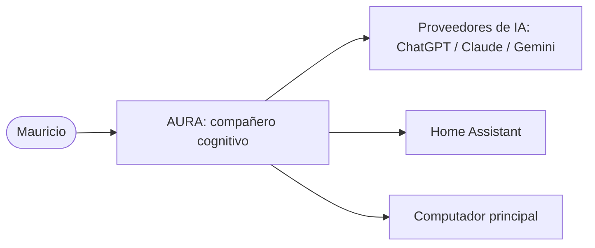

# 1.4 — Estándares Documentales, Plantillas y Ciclo de Vida de la Bible

> **Estado:** Aprobado (CEO, 2026-07-18) · **Prioridad:** P1 · **Responsable:** Sonnet (mantiene Haiku) · **Nivel:** Completo

*Convención † (1.1 §4): todo lo marcado con † es desarrollo del CTO/Engineering Manager sujeto al gate del CEO — no es texto de las actas del CEO ni de un capítulo ya aprobado. Toda atribución al CEO se cita textualmente entre comillas con su decisión de origen (acta Dn). Si no puede señalarse la frase del acta que lo sostiene, va con †.*

## Resumen ejecutivo

Este capítulo fija el estándar de calidad verificable de todo documento de la AURA Project Bible y el ciclo de vida por el que cada uno atraviesa durante años. Desarrolla —sin contradecir— lo ya normado: el frontmatter obligatorio y el versionado SemVer del acta D8, los estados y transiciones de la constitución (1.1 §6), la estructura estándar de capítulo del acta D13, el modo de trabajo documental del acta D12 y la convención de atribución honesta † (1.1 §4). Aporta la guía de estilo (español latino con términos técnicos en su forma original), las plantillas por artefacto (capítulo, acta, alerta, anexo, ADR), las convenciones de diagramas C4/Mermaid, la Definition of Done documental y un glosario inicial con el lenguaje ubicuo ya en uso. Propone además el ADR-0002 (plataforma de generación del sitio) con las cuatro opciones de nivel del acta D3, pendiente del gate del CEO.

## Objetivo

Fijar la calidad mínima verificable de todo documento de la Bible y cómo se versiona durante años, de modo que cualquier agente —humano o IA— produzca documentos consistentes, legibles y trazables, y que cada gate del CEO pueda decidir objetivamente si un documento está listo.

## 1. Guía de estilo documental

El alcance de esta guía —*"español latino + términos técnicos en su forma original"*— es la definición ratificada del índice v0.2; las reglas concretas son desarrollo del EM †.

- **Idioma:** español latino, registro profesional y directo. Se evitan el voseo y los localismos; se prefiere la segunda persona neutra o la forma impersonal.
- **Términos técnicos en su forma original†:** event bus, plugin, stub, gate, prompt, embedding, local-first, walking skeleton, etc., se escriben en su forma original (normalmente inglés), sin traducirse ni cursivarse de forma sistemática; su primera aparición relevante se define en el glosario (§9). No se inventan traducciones que fragmenten el lenguaje ubicuo.
- **Voz y honestidad†:** coherente con la identidad de AURA (D6, *"jamás aduladora"*), la redacción es sobria, sin superlativos de marketing. Cada afirmación fuerte se acompaña de su fuente o su evidencia.
- **Atribución (convención †):** nunca se atribuye al CEO lo que sus actas no dicen textualmente. Toda cita del CEO va entre comillas con la decisión de origen (p. ej., acta D8). Todo desarrollo propio del CTO/EM se marca con †.
- **Referencias y citas:** las referencias entre documentos usan enlaces relativos Markdown (§5); las citas de acta van entrecomilladas y trazadas a su decisión.
- **Números, fechas y unidades:** fechas en formato ISO `AAAA-MM-DD`; los umbrales cuantitativos se delegan a su capítulo dueño (p. ej., métricas a 2.5) y nunca se inventan en prosa.
- **Listas y tablas:** frases nominales, paralelas, sin puntuación final salvo que sean oraciones completas.

## 2. Frontmatter obligatorio y versionado SemVer (acta D8)

El acta D8 (rango 1) fija el mínimo: *"Versionado con Semantic Versioning. Cada documento lleva: versión, autor, fecha, estado e historial de cambios."* Esos cinco campos son obligatorios en todo documento. La constitución y el sistema de ADRs especializan el frontmatter por tipo de artefacto; el conjunto completo se codifica aquí como desarrollo del EM †.

**Campos por artefacto†** (los cinco campos núcleo del D8 en negrita):

| Artefacto | Frontmatter |
|---|---|
| **Capítulo** | **version, autor, fecha, estado, historial** + `capitulo`, `titulo`, `prioridad`, `responsable`, `nivel`, `dependencias`, `fecha_aprobacion` |
| **Acta / Brief del CEO** (rango 1) | `documento`, **version, autor, fecha, estado** (Vinculante), **historial** |
| **Anexo** | `documento`, `tipo`, **version, autor, fecha, estado**, `mantenido-por`, **historial** |
| **ADR** | Frontmatter especializado del **1.2 §5** (`numero`, `titulo`, `estado`, `fecha`, `fecha-resolucion`, `decisor`, `proponente`, `impacta`, `origen`, `reabre`, `supersede`, `superseded-por`, `motivo-rechazo`) |
| **Alerta de Arquitectura** | Frontmatter de la plantilla oficial / acta D16 (`documento`, `estado`, `fecha`, `emisor`, `trabajo-suspendido`) |

Los ADR y las alertas no repiten `version`/`autor` porque su identidad y autoría quedan capturadas por `numero`/`decisor`/`proponente` y `emisor`; su versionado de fondo es la inmutabilidad decisional (1.2 §2) y el registro en git.

**Versionado SemVer aplicado a documentos†:**

- **MAYOR (X.0.0):** cambio normativo que altera o contradice contenido previamente aprobado (requiere gate del CEO; en 1.1, enmienda constitucional).
- **MENOR (0.X.0):** contenido nuevo sustantivo que no contradice lo aprobado (nuevo borrador, incorporación de correcciones ratificadas, aplicación de un mandato de acta).
- **PARCHE (0.0.X):** correcciones editoriales sin efecto normativo (typos, enlaces rotos) — mantenimiento operativo (1.1 §3.1), sin gate.
- La primera aprobación del CEO lleva el documento a **1.0.0**; antes de esa aprobación vive en `0.y.z`.
- **Toda subida de versión añade una entrada al `historial`** (D8), con fecha y descripción. El historial es *append-only*: nunca se reescribe.

**Inmutabilidad tras aprobación:** en los ADR, el contenido decisional (Contexto, Alternativas, Decisión, Consecuencias) es inmutable tras `accepted` (1.2 §2); un cambio de fondo exige un ADR nuevo que lo supersede. En los capítulos, un cambio normativo posterior a la aprobación exige nueva versión mayor por el proceso que corresponda (gate o enmienda).

## 3. Ciclo de vida documental: niveles, estados y transiciones (desarrolla 1.1 §6)

La constitución (1.1 §6) ya fija —de forma normativa— los niveles y los estados con su autoridad de transición. Este capítulo los desarrolla operativamente **sin alterarlos**.

**Niveles (1.1 §6):** *Completo* (plantilla íntegra) o *Stub aprobado* (máximo 2 páginas: objetivo, decisiones clave, qué falta y cuándo se completará). En la v1.0, los capítulos P2/P3 no exceden el nivel stub.

**Estados y autoridad por transición (1.1 §6, normativo):**

| Transición | Autoridad |
|---|---|
| `No iniciado` → `Borrador` | El redactor asignado |
| `Borrador` → `En revisión` | El Responsable del capítulo |
| `En revisión` → `Aprobado` | **Solo el CEO** (gate) |
| cualquiera → `Obsoleto` | Solo mediante el ADR o la enmienda que supersede al documento |



Guía operativa por transición†:

- **No iniciado → Borrador:** el redactor asignado (Sonnet por defecto; Opus o Fable según el índice) crea el borrador a partir de la plantilla (§6), con version `0.y.z` y estado `Borrador`.
- **Borrador → En revisión:** el Responsable lo declara listo tras cumplir la Definition of Done (§8) y una revisión por un agente distinto del redactor (1.1 §4.2).
- **En revisión → Aprobado:** solo el CEO, en el gate. La aprobación lleva el documento a version `1.0.0` (o a la mayor siguiente si ya estaba aprobado), fija `fecha_aprobacion`, dispara la publicación (§5) y la actualización del índice.
- **cualquiera → Obsoleto:** nunca por decisión de un agente; solo el ADR o la enmienda que supersede al documento lo mueve a `Obsoleto`, con la referencia al instrumento que lo reemplaza.
- **Correcciones en borrador:** los ciclos `En revisión → Borrador` por correcciones no requieren gate y se registran en el historial como versión menor.

El silencio no aprueba (1.1 §3.2.6): solo la aprobación explícita del CEO cambia el estado a `Aprobado`.

## 4. Estructura estándar de capítulo (acta D13) y convención †

El acta D13 (rango 1) manda: *"Toda la documentación deberá ser legible tanto por humanos como por IA. Cada capítulo incluirá automáticamente: Resumen ejecutivo · Objetivo · Decisiones tomadas · Riesgos · Dependencias · Próximos pasos · Referencias cruzadas."* Este capítulo desarrolla el orden canónico y las secciones intermedias †.

**Orden canónico de un capítulo Completo:**

1. Frontmatter (§2).
2. Título `# n.n — Título`.
3. Línea de estado (blockquote): estado, prioridad, responsable, nivel.
4. **Declaración de la convención †**, cuando el capítulo contenga desarrollos del CTO/EM (todos los capítulos técnicos la llevan).
5. **Resumen ejecutivo** (D13).
6. **Objetivo** (D13).
7. **Secciones de contenido numeradas** † — el cuerpo técnico; su número y títulos los decide el Responsable.
8. **Decisiones tomadas** (D13), con la subsección **"Decisiones aplicables (ADRs)"** † que honra la trazabilidad del 1.2 §8 (lista los ADR `accepted` que gobiernan el capítulo, o "Ninguna aún").
9. **Riesgos** (D13).
10. **Dependencias** (D13).
11. **Próximos pasos** (D13).
12. **Referencias cruzadas** (D13).

**Convención † (1.1 §4):** distingue el texto de rango 1 (actas del CEO, citado textualmente) del desarrollo del CTO/EM que se vuelve exigible solo al aprobarse el capítulo. Es la regla más vigilada del proyecto: atribuir al CEO algo que sus actas no dicen es el error más grave. Regla práctica: si no puedes señalar la frase del acta que lo sostiene, va con †.

**Stub aprobado:** conserva Frontmatter, Título, Resumen ejecutivo, Objetivo, Decisiones tomadas (con "qué falta y cuándo") y Referencias cruzadas; puede condensar el resto. Máximo 2 páginas (1.1 §6).

## 5. Modo de trabajo documental y publicación (acta D12)

El acta D12 (rango 1) fija el modo documental: *"No se imprimirán documentos extensos en la terminal... La terminal muestra únicamente: resumen ejecutivo, cambios realizados, archivos modificados y preguntas que requieren aprobación."* Y: *"Cuando un documento quede aprobado se generan automáticamente su versión Markdown, PDF y HTML navegable, y se actualiza el índice de la Bible."* Y: *"Toda la documentación debe poder abrirse desde VS Code."*

Reglas operativas†:

- **Archivo primero:** todo documento vive como archivo Markdown en el repositorio; la terminal nunca es el soporte del contenido, solo del resumen y de las preguntas de gate.
- **No imprimir el capítulo:** durante un gate no se vuelca el capítulo completo en la terminal; se presentan su resumen ejecutivo, los cambios, los archivos afectados y las decisiones que requieren aprobación.
- **Publicación por evento (al aprobar):** la aprobación del CEO dispara la generación de HTML navegable y PDF y la actualización del índice. La herramienta que hoy materializa este mandato es [`herramientas/publicar.py`](../../herramientas/publicar.py): publica únicamente los documentos `Aprobado`/`Vinculante`/`accepted`.
- **Enlaces relativos:** todos los enlaces entre documentos son relativos y en Markdown, para que resuelvan tanto en el repositorio (VS Code) como en el sitio generado (el publicador reescribe `.md`→`.html`).
- **VS Code:** la documentación se mantiene abrible desde VS Code (D8, D12); no se usan formatos propietarios.

La elección del generador de sitio definitivo (*"MkDocs Material o Docusaurus"*, D8) está pendiente y se resuelve en el **ADR-0002** que este capítulo propone (ver "Decisiones aplicables").

## 6. Plantillas por artefacto

Plantillas mínimas por tipo †. Las de ADR y Alerta ya existen y son las únicas válidas: aquí se referencian, no se duplican.

### 6.1 Capítulo

```yaml
---
capitulo: "n.n"
titulo: "<título del capítulo>"
version: 0.1.0
autor: "<responsable> (rol, AURA Labs)"
fecha: AAAA-MM-DD
estado: "No iniciado"        # No iniciado | Borrador | En revisión | Aprobado | Obsoleto
prioridad: P0                # P0 | P1 | P2 | P3
responsable: "<agente>"
nivel: completo              # completo | stub
dependencias: ["n.n"]
historial:
  - version: 0.1.0
    fecha: AAAA-MM-DD
    cambio: "<descripción>"
---
```

Cuerpo: la estructura canónica de §4 (línea de estado, convención †, Resumen ejecutivo, Objetivo, secciones numeradas, Decisiones tomadas + Decisiones aplicables (ADRs), Riesgos, Dependencias, Próximos pasos, Referencias cruzadas).

### 6.2 Acta / Brief del CEO (rango 1)

Documento del CEO, registrado por el CTO; estado `Vinculante`.

```yaml
---
documento: "<nombre del acta o brief>"
version: 1.0.0
autor: "Mauricio (CEO) — registrada por <CTO>"
fecha: AAAA-MM-DD
estado: "Vinculante"
historial:
  - version: 1.0.0
    fecha: AAAA-MM-DD
    cambio: "<registro fiel de lo decidido por el CEO>"
---
```

### 6.3 Alerta de Arquitectura

No se define aquí: su plantilla oficial es [`decisiones/alertas/plantilla-alerta.md`](../../decisiones/alertas/plantilla-alerta.md), con la **estructura obligatoria de 10 secciones** del acta D16.

### 6.4 Anexo

Artefacto de apoyo (inventarios, catálogos, tablas de datos) referenciado por un capítulo; normalmente artefacto operativo (1.1 §3.1).

```yaml
---
documento: "<nombre del anexo>"
tipo: "Anexo — <capítulo que lo referencia>"
version: 0.1.0
autor: "<agente>"
fecha: AAAA-MM-DD
estado: "Borrador"
mantenido-por: "<agente> (artefacto operativo, 1.1 §3.1)"
historial:
  - version: 0.1.0
    fecha: AAAA-MM-DD
    cambio: "<descripción>"
---
```

### 6.5 ADR

No se define aquí: su plantilla oficial es [`adr/plantilla-adr.md`](../../adr/plantilla-adr.md) (1.2 §5), con la matriz de impacto del acta D11.

## 7. Convenciones de diagramas (C4 y Mermaid)

- **Modelo C4†:** la Bible usa los tres primeros niveles de C4 — **Contexto de sistema** (nivel 1), **Contenedores** (nivel 2) y **Componentes** (nivel 3). El nivel 4 (Código) se omite mientras no exista código; cuando exista, vivirá junto al código, no en la Bible. Las vistas C4 maestras son responsabilidad del capítulo 3.2; los demás capítulos las detallan sin contradecirlas.
- **Formato:** los diagramas se escriben en **Mermaid**, en bloques ` ```mermaid ` dentro del propio Markdown, para que sean legibles como texto (por humanos e IA, D13) y versionables por diff. No se incrustan imágenes binarias de diagramas salvo que Mermaid no baste.
- **Correlación con el texto:** todo diagrama va acompañado de una frase que lo explica; el diagrama nunca es la única fuente de una decisión.
- **Limitación actual (honesta)†:** el publicador `herramientas/publicar.py` **no renderiza Mermaid** (lo muestra como bloque de código); un generador como MkDocs Material o Docusaurus sí lo renderiza. Es uno de los argumentos del ADR-0002.

Ejemplo de vista de contexto (nivel 1), en Mermaid:



## 8. Definition of Done documental†

Un documento pasa de `Borrador` a `En revisión` solo si cumple TODO lo siguiente (lo verifica el Responsable; el revisor pre-gate lo re-verifica, 1.1 §4.2):

1. Frontmatter completo con los cinco campos del D8 + los campos del artefacto (§2); `version` e `historial` actualizados.
2. Estructura D13 completa (§4): las siete secciones obligatorias presentes y no vacías.
3. Convención † aplicada: toda atribución al CEO citada textualmente con su acta; todo desarrollo propio marcado con †.
4. "Decisiones aplicables (ADRs)" lista los ADR `accepted` que gobiernan el capítulo, o declara "Ninguna aún" (trazabilidad 1.2 §8).
5. Enlaces relativos válidos (resuelven en el repositorio); citas trazadas a su fuente.
6. Diagramas en Mermaid con su frase explicativa (§7), si aplica.
7. Estilo conforme a §1 (español latino; términos técnicos en su forma original).
8. Consistencia con las actas y los capítulos aprobados verificada; los conflictos no resueltos en la sesión quedan en [`decisiones/pendientes.md`](../../decisiones/pendientes.md) (1.1 §3.2.3).
9. Revisión por un agente distinto del redactor (1.1 §4.2) completada.
10. El documento se publica sin error con `herramientas/publicar.py` (o queda listo para publicarse al aprobarse, D12).

Para un stub, la DoD se limita a los puntos 1-5 y 9 sobre el contenido reducido del 1.1 §6.

## 9. Glosario inicial y lenguaje ubicuo

El glosario es la **fuente única del significado** de cada término: un término, un significado en toda la Bible (lenguaje ubicuo). Se mantiene como artefacto operativo a cargo de Haiku (1.1 §3.1) y crece con el proyecto.

| Término | Definición | Fuente |
|---|---|---|
| **ADR** | *Architecture Decision Record*: documento corto que captura una decisión arquitectónica (contexto, alternativas, decisión, consecuencias, impacto, trazabilidad); instrumento único de cambio arquitectónico. | 1.2 |
| **gate** | Punto de aprobación en el que el CEO decide si un documento pasa de `En revisión` a `Aprobado`; ningún agente aprueba en su nombre. Variantes: **gate de hito** (cierre de M1-M3, 2.2 §3.2) y **gate extraordinario** (convocado por una alerta o un circuito de fracaso). | 1.1 §6 |
| **stub** | Nivel de capítulo de máximo 2 páginas (objetivo, decisiones clave, qué falta y cuándo); los capítulos P2/P3 no exceden este nivel en la v1.0. | 1.1 §6 |
| **†** | Convención de atribución honesta: marca un desarrollo del CTO/EM sujeto al gate, que no proviene textualmente de un acta del CEO. | 1.1 §4 |
| **P-ARQ** | Principio arquitectónico numerado (P-ARQ-1 … P-ARQ-8) que toda decisión técnica debe respetar. | 3.1 §1 |
| **criterio-marco** | Criterio de éxito o fracaso que fija el principio pero delega su umbral cuantitativo al capítulo dueño (típicamente 2.5). | 2.1 §5 |
| **pendiente P-nnn** | Entrada del registro [`decisiones/pendientes.md`](../../decisiones/pendientes.md): conflicto o corrección que requiere decisión del CEO en el próximo gate. | 1.1 §3.2.3 |
| **alerta** (Alerta de Arquitectura) | Documento que el CTO levanta ante un riesgo a 5-10 años; suspende el trabajo afectado y convoca un gate extraordinario; sigue la estructura obligatoria de 10 secciones del acta D16. | actas D15/D16; 1.1 §4 |
| **artefacto operativo** | Documento que refleja decisiones ya tomadas sin crear reglas (índice, CHANGELOG, glosario, catálogos); lo mantienen Haiku/Sonnet, sin gate. | 1.1 §3.1 |
| **HITL** (Human-in-the-Loop) | Principio: toda acción crítica es auditable, explicable y reversible; nunca se sacrifica seguridad por comodidad. | acta D9; 3.1 (P-ARQ-1) |
| **local-first estricto** | Postura de datos: la información del usuario vive bajo su control; la nube solo para los usos autorizados; todo cifrado. | acta D1; ADR-0001 |
| **momento mágico** | Criterio de aceptación del MVP en palabras del CEO (D2). | acta D2; 2.2 §2 |
| **walking skeleton** | Corte mínimo de código que valida la arquitectura al cerrar la Bible. | 1.1 §7; cap. 7.3 |

## Decisiones tomadas

- Guía de estilo, especificación de frontmatter, desarrollo operativo del ciclo de vida, plantillas por artefacto, convenciones C4/Mermaid, Definition of Done y glosario inicial: **desarrollos del CTO/EM †** sobre lo normado en las actas D8, D12 y D13 y en los capítulos aprobados 1.1 §6 y 1.2 §5. Sujetos al gate del CEO.
- Se ratifica, **sin alterarlo**, el ciclo de niveles, estados y transiciones de la constitución (1.1 §6) y el mínimo de frontmatter del acta D8.
- Se **propone** el ADR-0002 (plataforma de generación del sitio documental) con las cuatro opciones de nivel del acta D3, pendiente del gate del CEO.

### Decisiones aplicables (ADRs)

- Ninguna en estado `accepted` gobierna aún este capítulo.
- Este capítulo **propone** el [ADR-0002 — Plataforma de generación del sitio documental](../../adr/0002-plataforma-documental-sitio.md) (`proposed`). Mientras siga en `proposed` no tiene valor normativo (1.1 §3: el rango 3 exige `accepted`); entre tanto, el publicador [`herramientas/publicar.py`](../../herramientas/publicar.py) opera como herramienta transitoria del mandato D12.

## Riesgos

- **Deriva documentación-realidad** si la Definition of Done no se aplica en cada gate (mitigación: DoD verificable §8 + verificación por evento 1.2 §8).
- **Legibilidad limitada del sitio actual†:** el publicador no ofrece búsqueda ni renderiza Mermaid, lo que degrada la legibilidad humana/IA que exige el D13 (mitigación: ADR-0002).
- **Plantillas rígidas** que induzcan relleno vacío o burocracia (mitigación: niveles Completo/Stub del 1.1 §6; la DoD exige secciones "no vacías", no extensas).
- **Glosario desactualizado** si no se mantiene (mitigación: es artefacto operativo a cargo de Haiku, 1.1 §3.1).
- **Enlaces rotos** al crecer la Bible (mitigación: enlaces relativos + verificación en la DoD; automatizable en el nivel Enterprise del ADR-0002).

## Dependencias

Capítulos: 1.1 (Aprobado, v1.3.0) — niveles, estados y transiciones; 1.2 (Aprobado, v1.1.0) — plantilla y trazabilidad de ADR. Herramienta: `herramientas/publicar.py` (mandato D12). Alimenta, como estándar transversal, a todos los capítulos y ADR futuros y a Haiku (mantenimiento de glosario, plantillas e índice).

## Próximos pasos

- Revisión adversarial interna (agente distinto del redactor) y gate del CEO de este capítulo.
- Gate del CEO sobre el **ADR-0002** con las cuatro opciones de nivel (D3): resolver la plataforma de sitio (*"MkDocs Material o Docusaurus"*, D8).
- Tras la aprobación: Haiku adopta plantillas y glosario como artefactos operativos y los mantiene sincronizados con el índice (D12).

## Referencias cruzadas

- [Acta de Decisiones (D3, D8, D12, D13)](../../decisiones/2026-07-17-acta-decisiones-fundacionales.md) · [Brief Fundacional](../../decisiones/2026-07-16-brief-fundacional.md)
- [Constitución 1.1 (v1.3.0)](1.1-constitucion-roles-autoridad.md) · [1.2 Sistema de ADRs (v1.1.0)](1.2-sistema-adrs-gestion-cambio.md)
- [Plantilla oficial de ADR](../../adr/plantilla-adr.md) · [Plantilla de Alerta de Arquitectura](../../decisiones/alertas/plantilla-alerta.md) · [ADR-0002 (proposed)](../../adr/0002-plataforma-documental-sitio.md)
- [Publicador `herramientas/publicar.py`](../../herramientas/publicar.py) · [Registro de pendientes](../../decisiones/pendientes.md) · [Índice maestro](../../INDICE.md)
