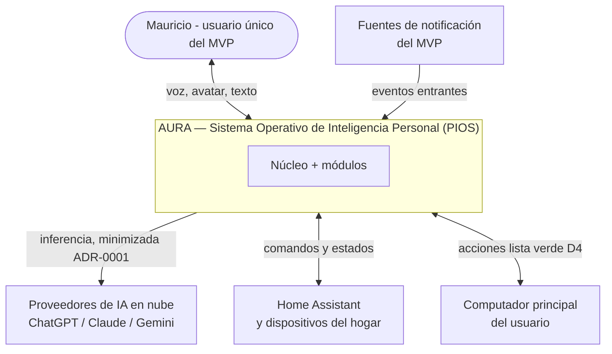
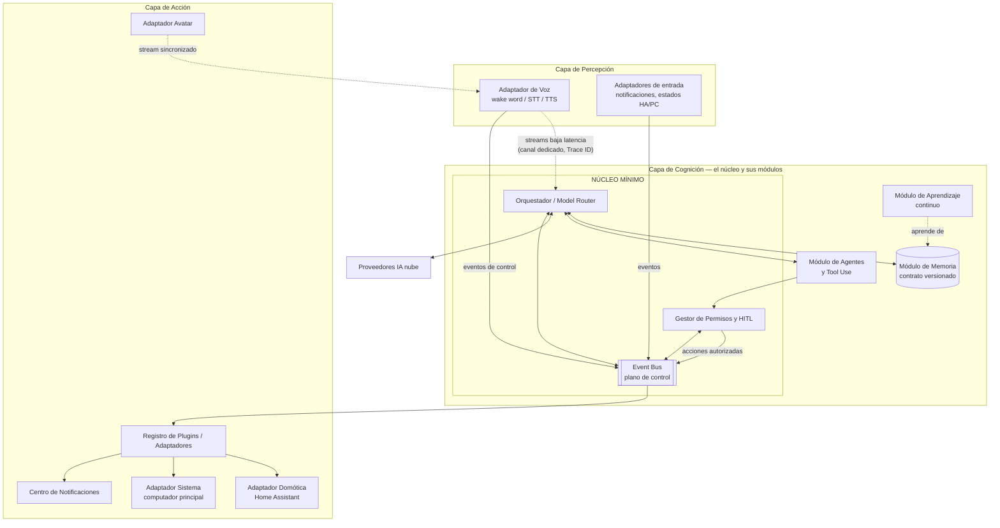
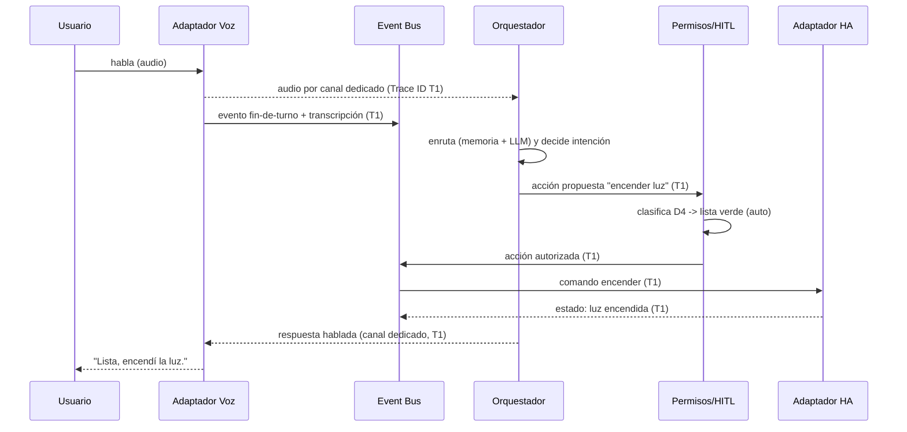

# 3.2 — Arquitectura de Referencia (Vistas C4)

> **Estado:** En revisión (gate del CEO) · **Prioridad:** P1 · **Responsable:** Fable

*Convención † (1.1 §4): desarrollo del CTO que se vuelve exigible con la aprobación de este capítulo — no es texto de actas del CEO.*

## Resumen ejecutivo

Este capítulo fija la **vista maestra** de AURA como PIOS (D18): la arquitectura de referencia que todos los capítulos técnicos posteriores detallan y respetan. Presenta las vistas **C4 de Contexto** (nivel 1) y **de Contenedores** (nivel 2), materializa la decisión estructural del 3.1 —**Event Bus como plano de control** para acciones discretas y **canales dedicados** para streams en tiempo real, correlacionados por Trace ID (resolución de la ALERTA-001)—, define el **núcleo mínimo** (orquestación, permisos, bus) con la **memoria como módulo** fuera de él, organiza el sistema en tres capas **percepción → cognición → acción**, y fija la **topología local-first** (ADR-0001) y la estructura **multi-usuario-ready** (P-ARQ-5). Traza el flujo extremo a extremo de una interacción de voz respetando el presupuesto de latencia oficial (2.5 §5.1). Todo contrato formal (eventos, plugins, datos) se delega a 3.3, 3.4 y 3.5.

## Objetivo

Establecer la arquitectura de referencia de AURA de modo que: (a) todo capítulo del Libro III-VII encaje en ella sin re-litigarla; (b) cada componente sea un módulo reemplazable por contrato (Evolución Permanente, D14); y (c) la estructura cumpla por diseño los principios del 3.1 y los umbrales del 2.5. Este capítulo define **la forma del sistema**, no sus contratos internos (3.3/3.4/3.5) ni su stack (3.6).

## 1. Alcance C4 y encuadre PIOS

Se usan los niveles 1-3 de **C4** (1.4 §7); este capítulo cubre **Contexto** (§3) y **Contenedores** (§4). El nivel 3 (Componentes) lo desarrollan los capítulos de cada contenedor. Encuadre rango 1 (D18): AURA es el **núcleo inteligente** que gobierna, bajo una sola arquitectura, los recursos cognitivos y digitales del usuario; los modelos de IA, dispositivos y servicios externos son **recursos/periféricos** conectados por contrato, no partes acopladas al núcleo.

## 2. Principios estructurales aplicados (referencia a 3.1)

Esta arquitectura es la aplicación directa de los P-ARQ ya aprobados (3.1); no introduce principios nuevos:

- **Event Bus plano de control + canales de streaming** (3.1 §2.1, ALERTA-001).
- **Núcleo mínimo**: solo lo que no puede fallar aislado sin detener el sistema (3.1 §2.1†).
- **Todo lo demás es plugin por contrato** (P-ARQ-3, ADR-0004).
- **Local-first** (P-ARQ-2, ADR-0001) y **multi-usuario-ready** (P-ARQ-5).
- **Observabilidad y trazabilidad** de percepción a acción (P-ARQ-7), con logs como dato del usuario (ADR-0001).

## 3. Vista de Contexto (C4 nivel 1)

AURA (el PIOS) en su entorno: un usuario, y los sistemas externos que gobierna como recursos.

Fronteras (ADR-0001): los datos del usuario, la memoria y las credenciales viven **dentro** de AURA (local); hacia la nube solo salen consultas a los 3 LLMs, minimizadas y cifradas (regla 5 del ADR-0001). Alexa/Google/HomeKit, NAS/Docker/Android y cámaras **no** están en el contexto del MVP (2.2 §4).

## 4. Vista de Contenedores (C4 nivel 2)

### 4.1 El núcleo mínimo

Contiene **solo** lo que no puede fallar de forma aislada sin detener todo el sistema (3.1 §2.1†):

- **Event Bus (plano de control):** transporta como eventos versionados toda **acción discreta** — eventos, comandos, auditoría, **operaciones de memoria**, decisiones, permisos y automatizaciones (ratificación del CEO en la ALERTA-001). Garantías de entrega, idempotencia y esquema → **3.3**.
- **Orquestador / Model Router:** decide qué recurso cognitivo atiende cada tarea (los 3 LLMs, la memoria, un agente) y ensambla el contexto. El diseño del router → **4.2**.
- **Gestor de Permisos y HITL:** evalúa toda acción contra las listas verde/roja (D4) antes de que toque un adaptador; ninguna acción llega a la capa de Acción sin pasar por aquí (P-ARQ-1). Diseño → **5.3**.

### 4.2 Módulos de cognición (fuera del núcleo)

Reemplazables por contrato versionado (ADR-0004); su interfaz vive en el núcleo, su implementación fuera:

- **Memoria** (episódica/semántica/procedimental): el subsistema más grande; **explícitamente fuera del núcleo** (P-002.2, coherente con D10 "toda inteligencia será desacoplada"). Sus operaciones viajan por el bus. Diseño → **4.1**.
- **Agentes y Tool Use:** planificación y ejecución de herramientas bajo HITL. Diseño → **4.3**.
- **Aprendizaje continuo:** adapta preferencias sin reentrenar; lee/escribe memoria. Diseño → **4.4**.

### 4.3 Capa de Percepción y Acción

- **Percepción:** el **Adaptador de Voz** (wake word, STT, TTS) emite audio por **canal dedicado de baja latencia** hacia el orquestador y **eventos de control** (inicio/fin de turno, transcripción final) por el bus, correlacionados por **Trace ID**. Otros adaptadores de entrada (estados de HA, del computador, notificaciones) emiten solo eventos.
- **Acción:** todo actuador es un **plugin sobre el contrato de 3.4/6.1** registrado en el **Registro de Plugins**; el MVP incluye Domótica (HA), Sistema (computador principal), Centro de Notificaciones y Avatar. Nada se conecta directo al núcleo.

### 4.4 Streams vs eventos (resolución ALERTA-001)

| Tipo | Ejemplos | Transporte | Traza |
|---|---|---|---|
| Acción discreta | comando, decisión, permiso, operación de memoria, notificación | **Event Bus** (versionado) | evento con Trace ID |
| Stream tiempo real | audio de voz, señal de avatar, (futuro: video, sensores) | **canal dedicado de baja latencia** | anclado a eventos de control por Trace ID |

Invariante† (lo garantiza 3.3): todo stream se abre y se cierra con eventos de control en el bus que comparten su Trace ID; sin esa correlación, la trazabilidad de una interacción (P-ARQ-1/7) se rompe.

## 5. Flujo extremo a extremo: una interacción de voz

Traza de "el usuario pide encender una luz", que ejercita el presupuesto de latencia oficial (2.5 §5.1):

Si la acción fuera de **lista roja** (p. ej. "abre la cerradura"), el Gestor de Permisos la detendría y pediría confirmación (RF-HITL, tolerancia cero a falsos negativos, 2.5 §5.4) antes de emitir la acción autorizada. El audio va por canal dedicado para cumplir P50 ≤ 800 ms; los eventos de control por el bus dan la traza auditable.

## 6. Topología de despliegue (local-first)

Vista física de referencia (el dimensionamiento de hardware y el stack concreto → 3.6; la infra de despliegue → 7.x):

- **En el hogar del usuario (local):** núcleo, memoria, permisos, bus, adaptadores, avatar y —cuando lleguen (R2)— los modelos locales. Aquí vive **todo dato del usuario** (ADR-0001).
- **En la nube (solo lo autorizado, D1):** inferencia de los 3 LLMs (entrada minimizada, regla 5 ADR-0001), y respaldos cifrados. Nada de memoria ni credenciales en claro sale del perímetro.
- **Modo degradado (2.5 §5.6):** si cae la nube, el núcleo, la memoria local y los comandos locales siguen; las funciones frontier se suspenden con aviso.

## 7. Estructura multi-usuario-ready (P-ARQ-5)

Aunque el MVP opera solo con Mauricio (D5), la arquitectura nace preparada (D5, D19): la **identidad de usuario es un eje transversal** que atraviesa memoria, permisos, automatizaciones y preferencias. Cada evento del bus y cada registro de memoria portan un `user_id`; el núcleo aísla los espacios por usuario. Habilitar multiusuario (R3) es activar más identidades, **no** rediseñar (el contrato ya lo contempla). El detalle de identidad y aislamiento → 5.4.

## Decisiones tomadas

- Vistas C4 de contexto (§3) y contenedores (§4) como arquitectura de referencia del PIOS; las capas percepción/cognición/acción, la ubicación de cada contenedor y el flujo §5 son desarrollo del CTO † sujeto a este gate.
- Aplicación de decisiones ya aprobadas (no nuevas): Event Bus plano de control + streams (ALERTA-001), núcleo mínimo con memoria fuera (3.1/P-002), local-first (ADR-0001), multi-usuario-ready (D5).
- Todo contrato formal se **delega**: eventos e idempotencia → 3.3; contrato de plugin → 3.4; modelo de datos → 3.5; stack y hardware → 3.6.

### Decisiones aplicables (ADRs)

- [ADR-0001 — Local-first estricto](../../adr/0001-postura-local-first-estricta.md) (`accepted`): gobierna §6 (topología) y las fronteras del §3.
- [ADR-0004 — Evolución Permanente](../../adr/0004-evolucion-permanente.md) (`accepted`): cada contenedor del §4 es un módulo reemplazable por contrato; el núcleo mínimo evita el monolito (D10).

### Evaluación por las cinco preguntas de largo plazo (D21)

(1) **Escala a 10 años:** el bus + plugins admite recursos nuevos sin tocar el núcleo. (2) **Reduce dependencia de proveedor:** los 3 LLMs son recursos tras el orquestador, sustituibles (P-ARQ-4). (3) **Sustituir sin rediseñar:** memoria, avatar, adaptadores y modelos son módulos por contrato. (4) **Mantenible por equipo pequeño:** núcleo mínimo + pocos contratos estables; no microservicios (regla 13 ADR-0004). (5) **Sistema vivo:** la estructura es la encarnación de la Evolución Permanente. Ninguna respuesta negativa → sin Alerta.

## Riesgos

- **Correlación bus↔stream:** un Trace ID perdido rompe la traza de una interacción de voz; 3.3 debe garantizar la correlación como invariante (§4.4).
- **Latencia del camino de voz:** el paso por orquestador+LLM presiona el presupuesto de 2.5 §5.1; si M1 no converge, circuito de fracaso (2.2 §3.5) — posible Alerta.
- **Núcleo que engorda:** la tentación de meter memoria/agentes al núcleo contradice D10; el criterio de pertenencia §4.1 y el checklist de 3.1 §2.3 lo previenen.
- **Multiusuario tardío:** si el `user_id` no se cablea desde el día uno, R3 exigiría rediseño (mitigación: §7 lo hace transversal ya).

## Dependencias

Capítulos (frontmatter): **3.1** (Aprobado — principios y estilo estructural), **2.5** (Aprobado — atributos y umbrales que la arquitectura debe cumplir). Se apoya en 2.1 v2.0.0 (PIOS), 2.2 (capacidades), ADR-0001 y ADR-0004. **Alimenta y delega a:** 3.3 (bus, eventos, correlación, idempotencia), 3.4 (contrato de plugins), 3.5 (modelo de datos y persistencia), 3.6 (stack e infra), 4.1/4.2/4.3/4.4 (módulos de cognición), 5.3 (permisos/HITL), 5.4 (identidad multiusuario), 6.1-6.5 (adaptadores), 7.x (despliegue).

## Próximos pasos

- Gate del CEO de este capítulo.
- Con 3.2 aprobado se desbloquea la ola ancha del Libro III: **3.3** (Núcleo Event-Driven y contratos, Opus), **3.4** (Plugins y Adaptadores, Opus), **3.5** (Modelo de Datos, Sonnet); **3.6** (Stack, Fable) ya está desbloqueado en paralelo (solo dependía de 3.1/2.5/1.5).

## Referencias cruzadas

- [Acta de Decisiones (D1, D5, D9, D18, D19, D21)](../../decisiones/2026-07-17-acta-decisiones-fundacionales.md) · [ALERTA-001 (bus vs streams)](../../decisiones/alertas/2026-07-17-alerta-001-bus-vs-streaming.md)
- [3.1 Principios (estilo estructural §2.1, 5 preguntas §2.5)](3.1-principios-arquitectonicos.md) · [2.5 Requisitos (umbrales)](../libro-02-vision-y-producto/2.5-requisitos-atributos-calidad.md)
- [2.1 Definición PIOS (v2.0.0)](../libro-02-vision-y-producto/2.1-vision-mision-anti-vision.md) · [ADR-0001](../../adr/0001-postura-local-first-estricta.md) · [ADR-0004](../../adr/0004-evolucion-permanente.md)
- Capítulos destino: 3.3, 3.4, 3.5, 3.6, 4.1-4.4, 5.3, 5.4, 6.1-6.5, 7.x · [Índice maestro](../../INDICE.md)
